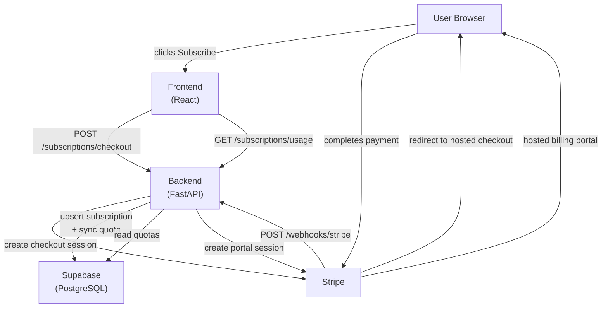

# Noesis Billing Architecture

Documentation for Noesis's payment tracking schema, Stripe webhook pipeline, subscription lifecycle, and quota management system.

## Architecture Overview

## Documents

| Document | Description |
|----------|-------------|
| [Database Schema](docs/schema.md) | Full schema for `subscriptions`, `stripe_webhook_events`, `user_quotas`, and `openai_usage_tracking` with ER diagram |
| [Webhook Pipeline](docs/webhook-pipeline.md) | Stripe webhook security, idempotency, event dispatch, and handler logic |
| [Billing Lifecycle](docs/billing-lifecycle.md) | Checkout flow, subscription state machine, dunning policy, and cancellation paths |
| [Quota System](docs/quota-system.md) | Per-user quota enforcement, monthly reset logic, and plan limits |

## Services

| Service | Path |
|---------|------|
| Stripe service | `services/backend/app/services/stripe_service.py` |
| Quota management | `services/backend/app/services/quota_management.py` |
| Subscription routes | `services/backend/app/api/routes/subscriptions.py` |
| Frontend billing page | `services/frontend/src/pages/Billing.tsx` |
| Frontend pricing page | `services/frontend/src/pages/Pricing.tsx` |

## Plan Tiers at a Glance

| Tier | Price | Projects | PDFs/mo | BibTeX/mo | Drafts/mo |
|------|-------|----------|---------|-----------|-----------|
| Free | $0 | 3 | 30 | 30 | 2 |
| Pro | $12/mo | 10 | 100 | 100 | 20 |
| Team | $20/user/mo | 999 | Unlimited | Unlimited | Unlimited |
| Enterprise | Custom | Custom | Custom | Custom | Custom |
