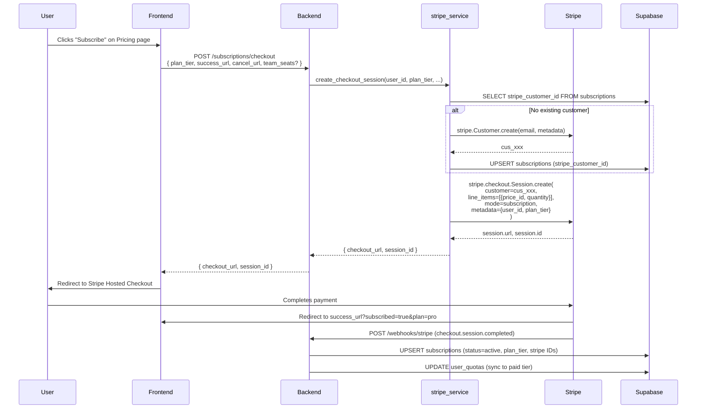
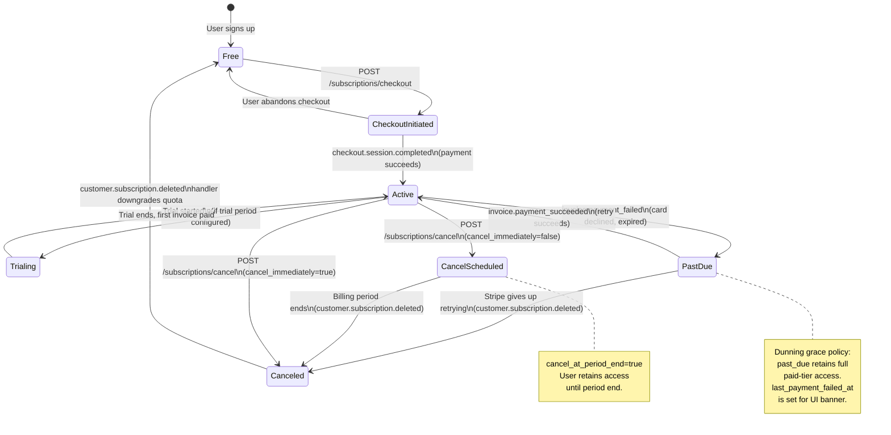
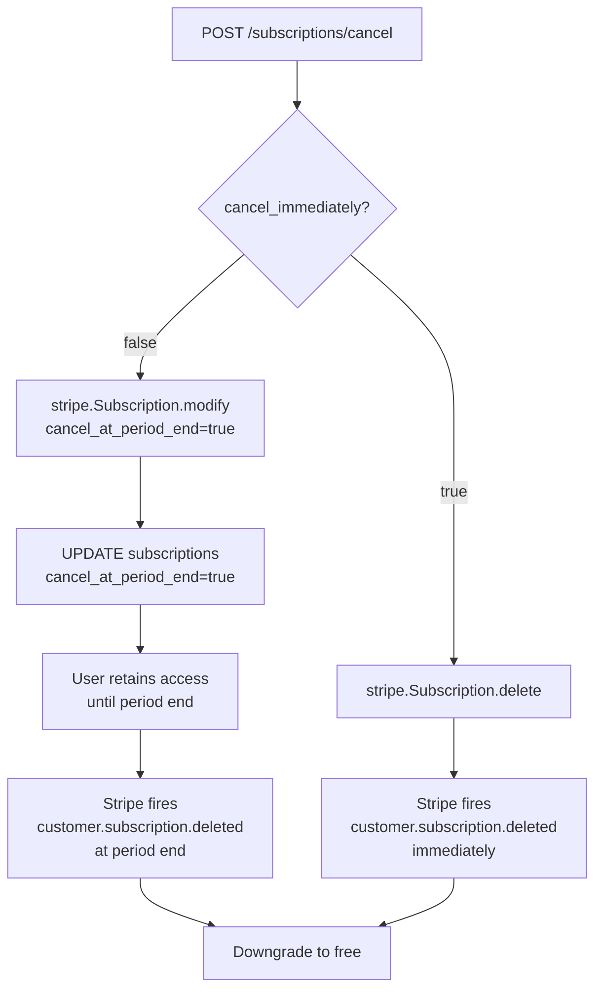

# Billing Lifecycle

End-to-end flow from initial signup through subscription management, covering checkout, subscription state transitions, dunning, and cancellation.

## Checkout Flow



---

## Subscription State Machine



---

## Dunning Policy

When a payment fails, Stripe retries automatically over several days. Noesis retains paid access throughout this window:

| Status | Access Level | `last_payment_failed_at` |
|--------|-------------|--------------------------|
| `active` | Full paid access | `NULL` |
| `past_due` | Full paid access (grace) | Set to failure timestamp |
| `canceled` / `incomplete` | Free tier only | Preserved (audit trail) |

On payment recovery (`invoice.payment_succeeded`), `last_payment_failed_at` is cleared and `status` returns to `active`. The frontend can read `last_payment_failed_at` to show a payment failure banner without hitting the Stripe API.

---

## Cancellation Flows



---

## Billing Portal

Users can manage their payment method, view invoices, and update their subscription directly via the Stripe Customer Portal:

```
POST /subscriptions/portal-session
→ stripe.billing_portal.Session.create(customer=cus_xxx, return_url=...)
→ { url: "https://billing.stripe.com/session/..." }
```

The portal is hosted and managed entirely by Stripe — no custom invoice or payment-method UI is needed on the Noesis side.

---

## Team Plan Seat Handling

The Team plan supports 2–3 paid seats. Seat count is adjustable at checkout and tracked in `subscriptions.seats`:

- **Checkout:** `adjustable_quantity` enabled with `minimum=2`, `maximum=3`
- **Webhook sync:** `items.data[0].quantity` from `customer.subscription.updated` is written to `seats`
- **Pricing:** $20 per seat per month
- **Quota:** all seats share a single user's quota row (team collaborator model not yet implemented)

---

## API Reference

| Endpoint | Auth | Purpose |
|----------|------|---------|
| `GET /subscriptions/plans` | None | Returns plan features and pricing |
| `POST /subscriptions/checkout` | Bearer | Creates Stripe Checkout session |
| `POST /subscriptions/cancel` | Bearer | Cancels subscription (immediate or at period end) |
| `GET /subscriptions/usage` | Bearer | Returns current usage counters and limits |
| `POST /subscriptions/portal-session` | Bearer | Creates Stripe Customer Portal session |
| `POST /webhooks/stripe` | Stripe signature | Receives and processes Stripe events |
