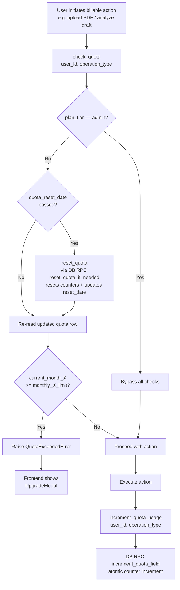
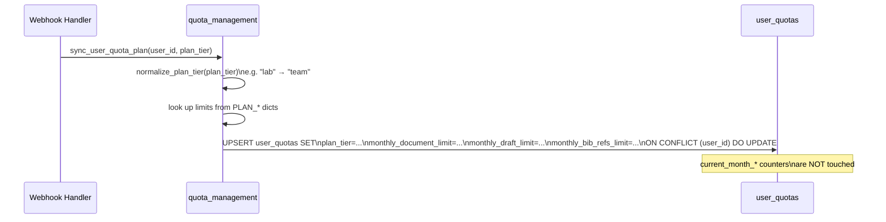
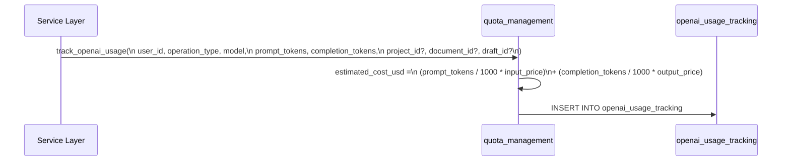

# Quota System

Per-user monthly usage tracking that enforces plan limits across PDF uploads, draft analyses, and BibTeX imports.

## Quota Check & Increment Flow



---

## Operation Type Mapping

| `operation_type` | Counter column | Limit column |
|-----------------|---------------|--------------|
| `document` | `current_month_documents` | `monthly_document_limit` |
| `draft` | `current_month_drafts` | `monthly_draft_limit` |
| `bib_import` | `current_month_bib_refs` | `monthly_bib_refs_limit` |

---

## Plan Limits

```mermaid
xychart-beta
    title "Monthly Limits by Plan"
    x-axis ["Free", "Pro", "Team"]
    y-axis "Limit" 0 --> 110
    bar [30, 100, 100]
    bar [2, 20, 100]
    bar [30, 100, 100]
```



| Resource | Free | Pro | Team / Enterprise |
|----------|------|-----|-------------------|
| PDF Uploads/mo | 30 | 100 | Unlimited (9999) |
| Draft Analyses/mo | 2 | 20 | Unlimited (9999) |
| BibTeX Imports/mo | 30 | 100 | Unlimited (9999) |
| Projects | 3 | 10 | 999 |
| Paper Discover/day | 5 | 50 | Unlimited |
| Literature Map/day | 5 | Unlimited | Unlimited |

---

## Quota Sync on Subscription Change

`sync_user_quota_plan(user_id, plan_tier)` is called by every webhook handler. It updates the limits in `user_quotas` **without resetting current-month counters**:



This means a user upgrading mid-month retains their already-used counter values — they simply gain access to the higher limits immediately.

---

## Monthly Reset

Each `user_quotas` row has a `quota_reset_date`. When `check_quota()` is called and the current time exceeds `quota_reset_date`, the reset procedure runs:

```sql
-- DB RPC: reset_quota_if_needed
UPDATE user_quotas
SET
    current_month_documents = 0,
    current_month_drafts    = 0,
    current_month_bib_refs  = 0,
    quota_reset_date        = NOW() + INTERVAL '1 month'
WHERE user_id = $1
  AND NOW() >= quota_reset_date;
```

Reset is lazy — it only fires when the user next performs a quota-checked action after the reset date passes. There is no background job.

---

## Cost Tracking

Every LLM call is recorded to `openai_usage_tracking` via `track_openai_usage()`:



This table is append-only and is used for operational cost attribution and billing analytics.

---

## Upgrade Modal Trigger

When `check_quota()` raises `QuotaExceededError`, the API returns a structured error response. The frontend reads the `quota_type` field and opens the `UpgradeModal` via the Zustand `useUpgradeModalStore`:

| `quotaType` | Shown when |
|-------------|-----------|
| `drafts` | Draft analysis limit hit |
| `documents` | PDF upload limit hit |
| `chat_messages` | Chat message limit hit |
| `paper_discovery` | Paper discovery limit hit |

The modal links to the Pricing page with the recommended plan pre-scrolled into view.
