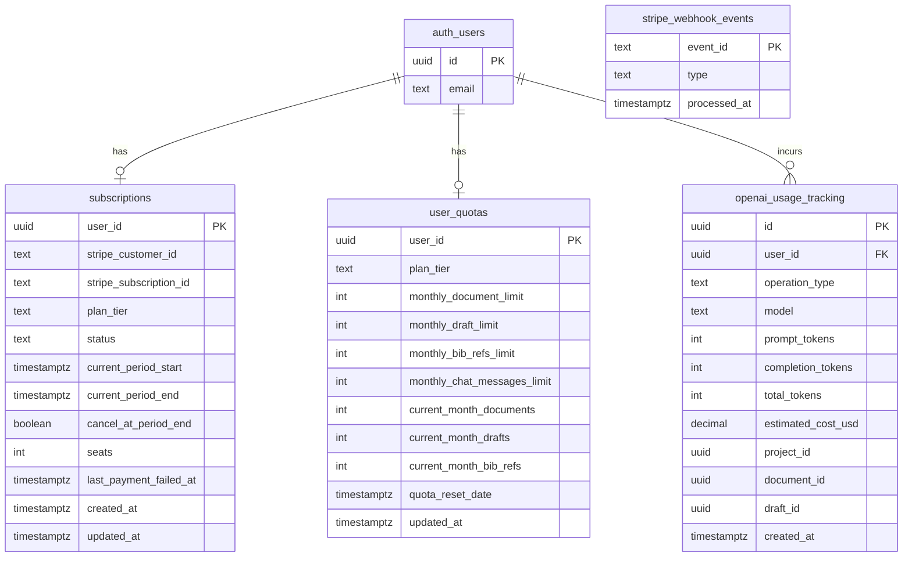

# Database Schema

Payment-related tables in the Noesis Supabase (PostgreSQL) database.

## Entity Relationship Diagram

---

## Table Reference

### `subscriptions`

Canonical record of a user's Stripe subscription. One row per user; upserted by webhook handlers.

| Column | Type | Notes |
|--------|------|-------|
| `user_id` | `UUID` | PK — foreign key to `auth.users` |
| `stripe_customer_id` | `TEXT` | Stripe `cus_*` ID; created on first checkout |
| `stripe_subscription_id` | `TEXT` | Stripe `sub_*` ID; set after checkout completes |
| `plan_tier` | `TEXT` | `free`, `pro`, `team`, `enterprise`, `admin` |
| `status` | `TEXT` | Stripe lifecycle status (see below) |
| `current_period_start` | `TIMESTAMPTZ` | Start of active billing period |
| `current_period_end` | `TIMESTAMPTZ` | End of active billing period |
| `cancel_at_period_end` | `BOOLEAN` | `true` when queued for cancellation |
| `seats` | `INTEGER` | Paid seat count (team plan only; `NULL` otherwise) |
| `last_payment_failed_at` | `TIMESTAMPTZ` | Set on `invoice.payment_failed`; cleared on `invoice.payment_succeeded` |
| `created_at` | `TIMESTAMPTZ` | Row creation time |
| `updated_at` | `TIMESTAMPTZ` | Last webhook update time |

**`status` values:**

| Status | Meaning | Paid Access? |
|--------|---------|-------------|
| `active` | Subscription current | Yes |
| `trialing` | In free trial | Yes |
| `past_due` | Payment failed, retrying | Yes (dunning grace) |
| `incomplete` | Initial payment pending | No |
| `canceled` | Subscription ended | No |

The dunning policy grants `past_due` users full paid-tier access. Quota is only downgraded to free on `canceled`/`incomplete` or `customer.subscription.deleted`.

---

### `stripe_webhook_events`

Idempotency log. Every processed webhook event is inserted here before handlers run, preventing duplicate processing on Stripe retries.

| Column | Type | Notes |
|--------|------|-------|
| `event_id` | `TEXT` | PK — Stripe `evt_*` ID |
| `type` | `TEXT` | e.g., `checkout.session.completed` |
| `processed_at` | `TIMESTAMPTZ` | Defaults to `NOW()` |

**Indexes:**
- `idx_stripe_webhook_events_type` on `(type)` — event-type monitoring
- `idx_stripe_webhook_events_processed_at` on `(processed_at DESC)` — time-range queries

**Access control:** Row Level Security enabled; no RLS policies → service role access only.

---

### `user_quotas`

Per-user monthly usage counters and plan limits. Updated by `sync_user_quota_plan()` on every subscription change and by `increment_quota_usage()` on each billable action.

| Column | Type | Notes |
|--------|------|-------|
| `user_id` | `UUID` | PK — foreign key to `auth.users` |
| `plan_tier` | `TEXT` | Normalized tier (`free`, `pro`, `team`, …) |
| `monthly_document_limit` | `INTEGER` | Max PDF uploads this month |
| `monthly_draft_limit` | `INTEGER` | Max draft analyses this month |
| `monthly_bib_refs_limit` | `INTEGER` | Max BibTeX imports this month |
| `monthly_chat_messages_limit` | `INTEGER` | Max chat messages (default 500) |
| `current_month_documents` | `INTEGER` | PDFs uploaded in current month |
| `current_month_drafts` | `INTEGER` | Drafts analyzed in current month |
| `current_month_bib_refs` | `INTEGER` | BibTeX refs imported in current month |
| `quota_reset_date` | `TIMESTAMPTZ` | When monthly counters reset |
| `updated_at` | `TIMESTAMPTZ` | Last write time |

**Plan limits:**

| Tier | PDFs/mo | BibTeX/mo | Drafts/mo | Projects | Discover/day |
|------|---------|-----------|-----------|----------|--------------|
| Free | 30 | 30 | 2 | 3 | 5 |
| Pro | 100 | 100 | 20 | 10 | 50 |
| Team | 9999 | 9999 | 9999 | 999 | Unlimited |
| Enterprise | 9999 | 9999 | 9999 | 999 | Unlimited |
| Admin | 9999 | 9999 | 9999 | 999 | Unlimited |

`sync_user_quota_plan()` updates limits without resetting current-month counters.

---

### `openai_usage_tracking`

Cost audit log — every LLM call is recorded for per-user cost attribution and operational visibility.

| Column | Type | Notes |
|--------|------|-------|
| `id` | `UUID` | PK |
| `user_id` | `UUID` | FK to `auth.users` |
| `operation_type` | `TEXT` | e.g., `document_analysis`, `chat`, `stage1_editing` |
| `model` | `TEXT` | e.g., `gpt-5.2`, `text-embedding-3-large` |
| `prompt_tokens` | `INTEGER` | Input token count |
| `completion_tokens` | `INTEGER` | Output token count |
| `total_tokens` | `INTEGER` | Sum |
| `estimated_cost_usd` | `DECIMAL` | Calculated from per-model pricing |
| `project_id` | `UUID` | Optional — originating project |
| `document_id` | `UUID` | Optional — originating document |
| `draft_id` | `UUID` | Optional — originating draft |
| `created_at` | `TIMESTAMPTZ` | Call timestamp |

**Model pricing (as of Oct 2026):**

| Model | Input (per 1K tokens) | Output (per 1K tokens) |
|-------|----------------------|------------------------|
| `gpt-5.2` | $0.00175 | $0.014 |
| `gpt-5.2-pro` | $0.00350 | $0.028 |
| `gpt-5-mini` | $0.00025 | $0.002 |
| `gpt-5-nano` | $0.00005 | $0.0004 |
| `text-embedding-3-small` | $0.00002 | — |
| `text-embedding-3-large` | $0.00013 | — |

---

## Migrations

| File | Change |
|------|--------|
| `026_stripe_webhook_events.sql` | Creates `stripe_webhook_events` idempotency table |
| `027_subscriptions_dunning_seats.sql` | Adds `seats` and `last_payment_failed_at` to `subscriptions` |
| `028_activation_funnel_view.sql` | Creates `user_activation_funnel` view and `get_activation_rate()` / `get_funnel_breakdown()` RPCs |
