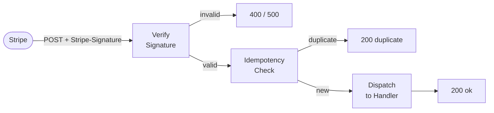
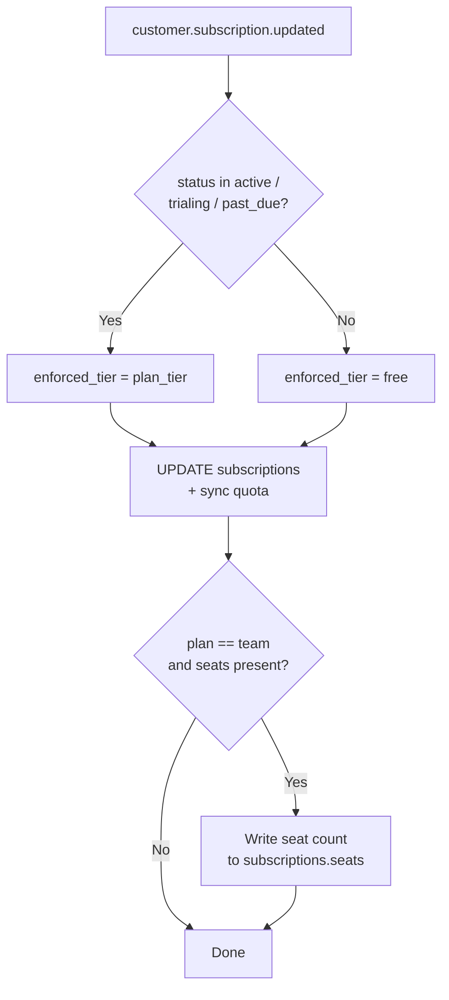

# Stripe Webhook Pipeline

The webhook endpoint at `POST /webhooks/stripe` is the single entry point for all Stripe-initiated state changes.

## Request Lifecycle



---

## Security Model

### Signature Verification

Every inbound webhook payload is verified using HMAC-SHA256 before any processing:

```
stripe.Webhook.construct_event(
    payload=raw_body,
    sig_header=request.headers["Stripe-Signature"],
    secret=STRIPE_WEBHOOK_SECRET
)
```

- **Missing secret in production/staging** → returns `500` (misconfiguration guard)
- **Invalid signature** → returns `400`
- **Development only** → signature check skipped; raw JSON parsed directly (supports `stripe trigger` for local testing)

### Idempotency

Stripe may deliver the same event more than once. The `stripe_webhook_events` table deduplicates:

```sql
INSERT INTO stripe_webhook_events (event_id, type)
VALUES ($1, $2)
ON CONFLICT (event_id) DO NOTHING;
```

If `rows_affected = 0`, the endpoint returns `200 {"status": "duplicate"}` without re-running handlers.

---

## Supported Events

| Event | Handler | DB Changes |
|-------|---------|-----------|
| `checkout.session.completed` | `handle_checkout_completed()` | Upsert `subscriptions`; sync `user_quotas` to paid tier |
| `customer.subscription.updated` | `handle_subscription_updated()` | Update status, billing period, `cancel_at_period_end`, `seats`; sync quota (paid or free based on status) |
| `customer.subscription.deleted` | `handle_subscription_deleted()` | Set `plan_tier=free`, `status=canceled`, `seats=NULL`; sync quota to free |
| `invoice.payment_failed` | `handle_invoice_payment_failed()` | Set `status=past_due`, record `last_payment_failed_at`; retain paid tier access |
| `invoice.payment_succeeded` | `handle_invoice_payment_succeeded()` | Clear `status=active`, clear `last_payment_failed_at`; re-sync quota to paid tier |
| Any other | — | Accepted (200), silently ignored |

---

## Error Handling

All handler functions are wrapped in broad exception handling:

```python
try:
    handler(data_object)
except Exception as e:
    logger.error(f"Error in {event_type} handler: {e}")
    # Not re-raised — endpoint still returns 200
```

The idempotency record is written **before** handlers run, so a crash on first delivery means a Stripe retry is treated as a duplicate and skipped. Failures surface in application logs / Sentry only.

---

## Environment Variables

| Variable | Purpose |
|----------|---------|
| `STRIPE_SECRET_KEY` | Stripe API authentication |
| `STRIPE_WEBHOOK_SECRET` | Webhook signature verification (`whsec_*`) |
| `STRIPE_PRICE_ID_PRO` | Price ID for Pro monthly plan |
| `STRIPE_PRICE_ID_TEAM` | Price ID for Team per-seat plan |

---

## Handler Detail: `handle_subscription_updated`

The most complex handler — determines the enforced quota tier from the incoming subscription status:


