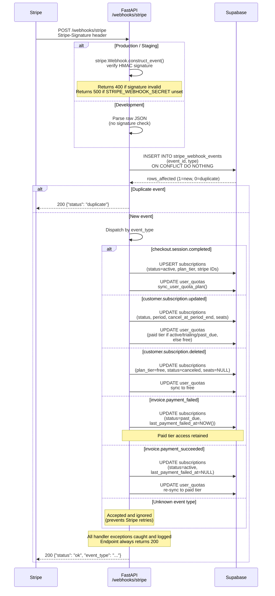

# Stripe Webhook Pipeline

The webhook endpoint at `POST /webhooks/stripe` is the single entry point for all Stripe-initiated state changes.

## Full Pipeline Sequence



---

## Security Model

### Signature Verification

Every inbound webhook payload is verified using HMAC-SHA256 before any processing:

```
stripe.Webhook.construct_event(
    payload=raw_body,
    sig_header=request.headers["Stripe-Signature"],
    secret=STRIPE_WEBHOOK_SECRET
)
```

- **Missing secret in production/staging** → returns `500` (misconfiguration guard)
- **Invalid signature** → returns `400`
- **Development only** → signature check skipped; raw JSON parsed directly (supports `stripe trigger` for local testing)

### Idempotency

Stripe may deliver the same event more than once (retries on non-2xx, network issues). The `stripe_webhook_events` table acts as a deduplication log:

```sql
INSERT INTO stripe_webhook_events (event_id, type)
VALUES ($1, $2)
ON CONFLICT (event_id) DO NOTHING;
```

If `rows_affected = 0`, the event was already processed — the endpoint returns `200 {"status": "duplicate"}` immediately without re-running handlers.

---

## Supported Events

| Event | Handler | DB Changes |
|-------|---------|-----------|
| `checkout.session.completed` | `handle_checkout_completed()` | Upsert `subscriptions`; sync `user_quotas` to paid tier |
| `customer.subscription.updated` | `handle_subscription_updated()` | Update status, billing period, `cancel_at_period_end`, `seats`; sync quota (paid or free based on status) |
| `customer.subscription.deleted` | `handle_subscription_deleted()` | Set `plan_tier=free`, `status=canceled`, `seats=NULL`; sync quota to free |
| `invoice.payment_failed` | `handle_invoice_payment_failed()` | Set `status=past_due`, record `last_payment_failed_at`; retain paid tier access |
| `invoice.payment_succeeded` | `handle_invoice_payment_succeeded()` | Clear `status=active`, clear `last_payment_failed_at`; re-sync quota to paid tier |
| Any other | — | Accepted (200), silently ignored |

---

## Error Handling

All event handler functions are wrapped in broad exception handling:

```python
try:
    handler(data_object)
except Exception as e:
    logger.error(f"Error in {event_type} handler: {e}")
    # Not re-raised — endpoint still returns 200
```

This design means:
- Stripe never retries due to a handler crash (retries would cause duplicate-processing noise)
- Handler failures surface in application logs / Sentry only
- The idempotency record is written **before** handlers run, so a crash on first delivery means a retry would be treated as a duplicate

---

## Environment Variables

| Variable | Purpose |
|----------|---------|
| `STRIPE_SECRET_KEY` | Stripe API authentication |
| `STRIPE_WEBHOOK_SECRET` | Webhook signature verification (`whsec_*`) |
| `STRIPE_PRICE_ID_PRO` | Price ID for Pro monthly plan |
| `STRIPE_PRICE_ID_TEAM` | Price ID for Team per-seat plan |

---

## Handler Detail: `handle_subscription_updated`

The most complex handler — it must correctly determine the enforced quota tier from the incoming status:

```mermaid
flowchart TD
    A[customer.subscription.updated] --> B[Extract status, plan_tier,\nperiod, seats from payload]
    B --> C{status in\nactive / trialing / past_due?}
    C -- Yes --> D[enforced_tier = plan_tier]
    C -- No --> E[enforced_tier = free]
    D --> F[UPDATE subscriptions]
    E --> F
    F --> G[sync_user_quota_plan\nenforced_tier]
    G --> H{plan_tier == team\nand seats not null?}
    H -- Yes --> I[SET seats = quantity\nfrom items.data\[0\].quantity]
    H -- No --> J[Leave seats unchanged]
    I --> K[Done]
    J --> K
```
